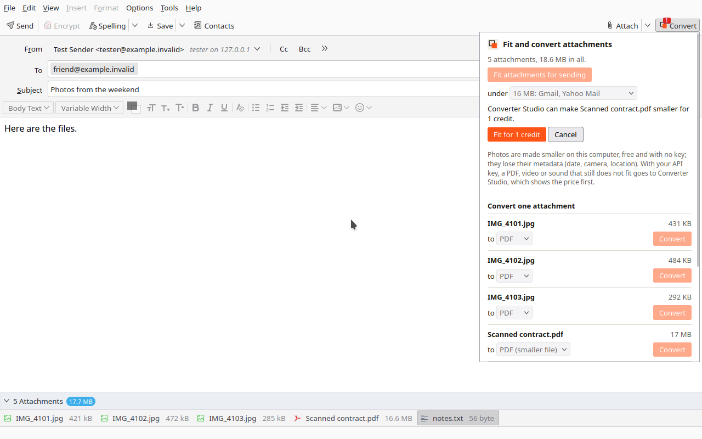

# Converter Studio for Thunderbird

Make e-mail attachments small enough to send, and convert them with
[Converter Studio](https://converter.studio), right in Thunderbird:

- **Fit attachments for sending:** one click brings all of a message's attachments under 16 MB
  (gets through Gmail and Yahoo Mail) or 10 MB (Outlook.com and iCloud Mail too). Photos are made
  smaller on your computer, free and with no account; a PDF, video or sound that still does not fit
  is made smaller by Converter Studio with your API key, after you see the price.
- **While you write a message:** turn an iPhone photo (HEIC) into a JPG, a Word document into a PDF,
  a PDF into a smaller PDF or a video into an MP4 before you send it. The converted file replaces the
  attachment, or is attached beside it.
- **In a message you received:** convert an attachment and save the result, for example a HEIC photo
  as a JPG or a DOCX as a PDF.

The list of formats each file can become comes from Converter Studio itself (67 formats: images,
documents, spreadsheets, slides, e-books, audio, video, subtitles and archives), so it grows when
Converter Studio adds formats, without an update of the add-on.




## Requirements

- Thunderbird **153 ESR or newer** (tested on 153.7.0esr and 160.0).
- Nothing else to make photos smaller with **Fit attachments for sending**.
- To convert attachments, and to fit a PDF, video or sound: a Converter Studio account and an API
  key. Sign up at [converter.studio](https://converter.studio), then create a key on the
  [account page](https://converter.studio/account#api-keys). Free accounts get 25 credits a day;
  most photos and documents cost 1 credit; audio and video are priced by their length, and video
  also by its frame size. See [pricing](https://converter.studio/pricing).

## Installation

In Thunderbird, open **Tools → Add-ons and Themes**, search for **Converter Studio** and click **Add
to Thunderbird**. Or download the `.xpi` file of a release and choose **Install Add-on From File…**
from the gear menu of the Add-ons Manager.

## Setup

Open the add-on's options (**Tools → Add-ons and Themes → Converter Studio → Options**):

| Setting                                           | What it does                                                                                                                                                              |
| ------------------------------------------------- | ------------------------------------------------------------------------------------------------------------------------------------------------------------------------- |
| **API key**                                       | Your key (`cvs_live_…`). **Check the key** shows your plan and credits.                                                                                                   |
| **Ask before a conversion that costs more than…** | Default 20 credits. A dearer conversion (a long video) waits in the popup until you click **Convert for N credits**, and costs nothing until then.                        |
| **Advanced: Converter Studio address**            | `https://converter.studio/api`. Only a test server on your own computer (`localhost` or `127.0.0.1`) can be set instead; Thunderbird then asks you to allow that address. |

**Where the key is kept:** in Thunderbird's extension storage (`storage.local`), inside your
Thunderbird profile on this computer. It is not synced anywhere, it is not encrypted (like the
settings of other add-ons and Thunderbird's own preferences), only this add-on can read it, and it is
deleted when you remove the add-on. The key is sent only to the Converter Studio address above.

## Use

**Fit attachments for sending:** attach files as usual, click **Convert** in the toolbar of the
compose window, choose the size (**16 MB: Gmail, Yahoo Mail** or **10 MB: also Outlook.com,
iCloud**; remembered) and click **Fit attachments for sending**. The cheapest way comes first:

1. If the attachments already come to less, nothing changes and the popup says so.
2. Photos (JPEG, PNG, WebP and iPhone HEIC) are made smaller on this computer, largest first and
   only until it fits: the long side at most 2048 px at a good JPEG quality, and only if that is not
   enough, a lower quality and then 1600 or 1280 px. The picture is turned the right way up. A PNG
   without transparency may become a JPG; a graphic with transparency stays a PNG and is only
   resized; a HEIC photo becomes a JPG (with a `.jpg` name).
3. What still does not fit and only Converter Studio can make smaller (a PDF, a video, a sound, or a
   photo this computer cannot read) is sent there, with your API key, for a price first:
   **Fit for N credits** or **Cancel** (nothing is charged then). A PDF is compressed, a video
   becomes a smaller MP4 and a sound a smaller MP3, each within its share of what is left; an MP4
   stays an MP4 and an MP3 an MP3, with the same name. One Converter Studio cannot make smaller
   comes back as it was and costs nothing: it stays, and the outcome line says so. Without a key,
   the popup names these attachments and what a key would do.

Each attachment is replaced in its place, with its name, only once its smaller copy is ready; when
something fails, it stays as it was. The popup ends with one line, for example "5 attachments,
41.5 MB → 1.8 MB. Fits Gmail, Yahoo Mail, Outlook.com and iCloud Mail." If it still cannot fit, it
names what is too big; Thunderbird's own **Filelink** can send such files as links instead.

**Photos made smaller lose their metadata** (EXIF: the date, the camera and the location).

**Converting one attachment:** attach files as usual, then click **Convert** in the toolbar of the compose
window. Pick a format for an attachment and click **Convert**. Choose at the bottom whether the
converted file **replaces the attachment** or **is attached beside it**. The popup shows each step;
you can close it, the conversion goes on, and the button shows how many are running.

**Reading a message:** click **Convert** in the message's header toolbar, pick a format and click
**Convert and save**. The file is saved like any other download, following Thunderbird's setting in
**Settings → General → Files & Attachments** (a fixed folder, or asked each time). The first time,
the add-on asks for permission to read messages and to save files (see below), then restarts once
(Thunderbird sets up its message functions for an add-on when it starts), and you click **Convert**
again.

## Permissions

| Permission                                                                   | When       | Why                                                                                                                                                |
| ---------------------------------------------------------------------------- | ---------- | -------------------------------------------------------------------------------------------------------------------------------------------------- |
| Read and modify your email messages as you compose and send them (`compose`) | at install | To read an attachment you choose to convert (or the attachments you fit), and to replace it or attach the result. Nothing else is read or changed. |
| Transfer sensitive user data to a remote server (`sensitiveDataUpload`)      | at install | Thunderbird's notice that the attachments you convert are sent to Converter Studio.                                                                |
| Access your data for converter.studio (host permission)                      | at install | To reach the Converter Studio API.                                                                                                                 |
| `storage` (no prompt)                                                        | at install | To keep your settings.                                                                                                                             |
| Read your email messages (`messagesRead`)                                    | first use  | Only for converting an attachment of a message you received; asked for the first time you do.                                                      |
| Downloads (`downloads`)                                                      | first use  | To save that converted attachment.                                                                                                                 |

## Privacy

- Only the attachments you choose to convert are sent to Converter Studio, over HTTPS, with your API
  key. **Fit attachments for sending** makes photos smaller on this computer and sends no photo it
  can read; with your key, it sends what only Converter Studio can make smaller, to get its price.
  If you cancel, nothing is charged and Converter Studio deletes those files within 30 minutes.
  Opening a popup sends nothing but, at most once a day, a request for the list of formats (which
  carries no data about you or your mail).
- Converter Studio deletes the uploaded file as soon as the conversion finishes, and the converted file
  6 hours later; the add-on downloads it at once. Your account keeps a short history of your
  conversions (file names, formats and credits). See the
  [privacy policy](https://converter.studio/privacy).
- The add-on reads no message text, addresses or other attachments, collects no statistics and loads
  no remote code. Each request names the add-on and its version (the header
  `X-Converter-Studio-Client`) so Converter Studio can count conversions made from Thunderbird.

## Limits

- The largest file depends on your plan (the add-on shows Converter Studio's message when a file is too
  large). Attachments sent as links (Filelink, cloud attachments) are not converted.
- One message at a time in the message window: open a single message, not a selection.
- A PDF that does not get smaller is left as it is, and Converter Studio's own messages are shown as
  they come (for example a damaged file, or a format it cannot make from that file).
- Conversions run while Thunderbird is open; a conversion is lost if Thunderbird is closed during it
  (the attachment stays as it was).
- **Fit attachments for sending** counts the attachments' own size, as Thunderbird lists them (mail
  programs send them about a third larger, which the 16 and 10 MB allow for). Pictures inside the
  message text are not attachments and are left alone. Thunderbird does not tell add-ons which
  attachments it sends as links (Filelink), so they count like the others: fit before you switch an
  attachment to a link. Animated GIFs, documents (Word, Excel…) and archives are not made smaller.

## Development

The add-on is plain JavaScript modules in `src/`, shipped as they are: there is no bundler, no
minifier and no npm dependency, so the `.xpi` holds exactly the files of `src/`. The one
third-party library, the HEIC decoder libheif-js 1.23.5 (LGPL-3.0, WebAssembly), is an unmodified
copy of its npm release in `src/vendor/libheif-js/`; [`src/VENDOR.md`](src/VENDOR.md) names its
source and checksums, and Thunderbird's linter verifies it against the release.

```sh
npm test                    # unit tests (Node's own test runner): API client, formats, jobs, fitting,
                            # photos, the HEIC decoder, manifest
npm run build               # dist/converter-studio-<version>.xpi
tools/webext-linter.sh      # Thunderbird's own linter (thunderbird/webext-linter), on the built XPI
```

To try it, choose **Debug Add-ons** in the Add-ons Manager's gear menu, then **Load Temporary
Add-on…** and pick `src/manifest.json`.

## Support

Write to [support@converter.studio](mailto:support@converter.studio), or open an issue at
[github.com/tariksucu/thunderbird-converter-studio](https://github.com/tariksucu/thunderbird-converter-studio/issues).

## License

[MIT](LICENSE), © Converter Studio. The bundled libheif-js is LGPL-3.0 (its licence texts are in
`src/vendor/libheif-js/`).
